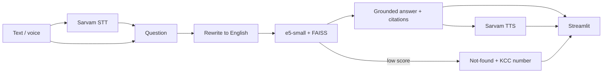

# कृषी मित्र — Krishi Mitra

A Marathi voice farm-advisory assistant (RAG + speech) for farmers in Sangli/Kolhapur
(sugarcane, grapes, turmeric). Ask by typing or speaking in Marathi, Hindi or English; get a
short answer with citations (document + page), read aloud, plus the source passages. If the
answer is not in the trusted sources, the app says so and points to Kisan Call Centre
(1800-180-1551) or the local KVK instead of guessing.

## Problem statement
Farmers need timely, trustworthy advice in their own language, but expert material (ICAR,
state universities, government guidelines) is long, English and hard to search. General chatbots
can invent pesticide doses. Krishi Mitra answers only from vetted documents and shows its sources.

## Architecture

Details and viva Q&A: [docs/ARCHITECTURE.md](docs/ARCHITECTURE.md).

## Models and why
| Role | Model | Why |
|---|---|---|
| Speech-to-text | Sarvam `saaras:v4` | Strong Marathi/Indic ASR, API (no local model) |
| Text-to-speech | Sarvam `bulbul:v3` | Natural Marathi voice, API; local Parler-TTS too slow on CPU |
| Chat LLM | Sarvam `sarvam-105b` | Indic-language answers |
| Fallback LLM | Groq `llama-3.3-70b-versatile` | Fast, independent provider |
| Embeddings | `intfloat/multilingual-e5-small` | Small (~120 MB), multilingual, runs on CPU |
| Vector search | FAISS `IndexFlatIP` | Exact cosine search, trivial for a few thousand chunks |

## Setup
```bash
python3.11 -m venv .venv && source .venv/bin/activate
pip install -r requirements.txt
cp .env.example .env                      # add SARVAM_API_KEY and GROQ_API_KEY
# put the PDFs listed in data/sources.csv into data/raw/ (filenames must match)
python -m src.ingest                      # builds data/index/ (commit it)
streamlit run app.py --server.fileWatcherType none   # "none" hides harmless torchvision log spam locally
```
Useful: `python -m src.llm "..."`, `python -m src.speech` (TTS→STT round trip),
`python -m eval.run_eval [--no-llm]`, `python -m eval.run_eval --cache`.

## Deploy on Streamlit Community Cloud
1. Push this repo to GitHub (public or private). `data/index/` **must** be committed; `.env` and `.streamlit/secrets.toml` must not be.
2. share.streamlit.io → *New app* → pick the repo, branch `main`, main file `app.py`.
3. *Advanced settings* → Python version **3.11**; paste in the *Secrets* box:
   ```toml
   SARVAM_API_KEY = "..."
   GROQ_API_KEY = "..."
   ```
4. Deploy, then open the app and test one text question and one voice question.
5. `demo_cache.json` (answers to the 6 example questions) is already committed as an offline safety net. If you change the examples in `src/config.py`, re-run `python -m eval.run_eval --cache` and commit it.
   Open the app once beforehand so it is not asleep.

## Evaluation results
Run: `python -m eval.run_eval` (34 questions: 29 in-scope in Marathi/English, 5 out-of-scope). Raw rows in `eval/results.csv`.

| Metric | Value |
|---|---|
| Retrieval hit@1 (right source document ranked first) | 97% |
| Retrieval hit@5 | 100% |
| Refusal accuracy on out-of-scope questions | 100% |
| In-scope questions wrongly refused | 7% (2 of 29) |
| Avg latency: query rewrite / retrieval / answer | 0.5 s / 0.03 s / 1.2 s |
| Avg latency: text-to-speech | about 4 s (runs after the text answer is ready) |
| App memory (Streamlit + embedding model + index) | about 1.0 GB |

**Refusal design.** The similarity threshold (`SCORE_THRESHOLD = 0.84`) was chosen from the eval sweep: it keeps 100% of in-scope questions and refuses 80% of out-of-scope ones before any LLM call. The rest are refused by the answer prompt ("not in the context -> say so, give Kisan Call Centre number"). Both layers together refused all 5 out-of-scope questions.

**Caveats.** The test set is small and written by us; the sugarcane source is a research-station profile (planting time, fertiliser, weeds, varieties) rather than a full package of practices, so pest/disease questions on sugarcane are correctly refused.

## Limitations
- Knowledge base is 5 documents (turmeric, grapes, sugarcane, PM-KISAN, MPKV varieties); anything outside gets a refusal.
- Sources are English; Marathi answers are LLM translations of English passages.
- Speech recognition can mis-hear dialects, noise and crop/pest names.
- PDFs with legacy (non-Unicode) fonts extract as garbage text (one MPKV phrase is affected; chunks that are mostly junk are dropped at ingestion).
- Embedding similarity scores are compressed (relevant 0.84-0.92, irrelevant 0.77-0.85), so the threshold alone is imperfect; the LLM refusal rule backs it up.
- Free-tier APIs have rate limits and latency; the demo cache covers the example questions only.

## Ethics
- **Hallucination:** answers are restricted to retrieved text, cited, and refused when unsupported; sources are shown so users can verify.
- **Dosage safety:** chemical doses are quoted exactly from sources, always with "consult local agriculture officer / KVK".
- **Privacy:** voice and text are sent to third-party APIs (Sarvam, Groq); this app stores nothing. Users are told in the sidebar.
- **Language/dialect bias:** ASR/TTS quality varies by dialect and accent; Marathi may perform worse than Hindi/English.
- **Not a replacement** for agronomists, KVK or the Kisan Call Centre.

## Future scope
More crops and Marathi-language sources (MPKV, Krishi Vidnyan Kendra bulletins), weather and mandi-price tools,
WhatsApp/IVR access for feature phones, dialect-aware ASR, feedback buttons, a re-ranker, a Kisan Call Centre dataset for evaluation.
