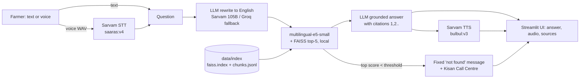

# Architecture — Krishi Mitra

## Data flow, step by step

1. **Offline (once):** `python -m src.ingest` reads PDFs in `data/raw/`, extracts text per page (PyMuPDF), cleans it, cuts ~800-character chunks with 150 overlap, embeds them with `passage: ` prefix, and saves a FAISS index plus `chunks.jsonl` (text + title, publisher, URL, crop, page). The index is committed to git, so the app never embeds documents at startup.
2. **Speech to text:** if the farmer spoke, the WAV from `st.audio_input` goes to Sarvam STT (language auto-detect).
3. **Query rewrite:** the LLM converts the question to a short English search query (the PDFs are English). If the LLM is down we search with the original text; e5 is multilingual.
4. **Retrieval:** the query is embedded with the `query: ` prefix; FAISS inner product over normalised vectors = cosine similarity. A crop filter keeps the chosen crop plus scheme documents.
5. **Refusal check:** if the best score is under `SCORE_THRESHOLD`, a fixed message is returned without calling the LLM.
6. **Grounded generation:** the top-8 chunks are numbered in the prompt. The model must answer only from them, cite `[n]`, reply in the chosen language and add the dosage disclaimer.
7. **Text to speech:** citation markers are stripped and the answer is synthesised (split at 2000 characters if needed). TTS failure never hides the text answer.
8. **Fallbacks:** Sarvam LLM → Groq on error/20 s timeout; if all APIs fail, `demo_cache.json` is searched for a near-identical question.

## Why RAG, not fine-tuning?
- Answers must be traceable to a page of an official document; fine-tuning bakes facts into weights with no citation.
- Updating knowledge = add a PDF and re-run ingest, versus retraining.
- No GPU or training data needed; fine-tuned models still hallucinate doses.

## Why APIs for speech and LLM?
Streamlit Community Cloud gives about 2.7 GB RAM and CPU only. A local LLM or ASR does not fit, and Indic Parler-TTS is far too slow on CPU for an interactive demo. Only the small embedding model (~120 MB) and FAISS run in the app. Sarvam is built for Indian languages (Marathi STT/TTS/LLM); Groq is a fast independent fallback so one outage does not kill the demo.

## Likely viva questions
- **What is a chunk and why overlap?** A ~800-character slice of a page. Overlap keeps a sentence that straddles a boundary intact in at least one chunk.
- **Why normalise embeddings?** Then inner product equals cosine similarity, which is what e5 is trained for.
- **Why the `query:` / `passage:` prefixes?** The e5 model card requires them; omitting them lowers retrieval quality.
- **How do you stop hallucination?** Answer-only-from-context prompt, numbered citations, temperature 0.2, a retrieval score floor with a fixed refusal, and visible sources so a user can check.
- **How do you know it works?** `eval/run_eval.py`: hit@1/hit@5 against expected source document, refusal rate on out-of-scope questions, latency per stage.
- **Why is the similarity threshold hard to set?** e5-small scores are compressed (relevant ≈ 0.84–0.92, irrelevant ≈ 0.77–0.85). We picked 0.84 from the eval sweep (keeps all in-scope questions) and rely on the LLM's own "not in context" rule for the rest.
- **Privacy?** Voice and text go to Sarvam/Groq over HTTPS; the app stores nothing.
- **What if Sarvam is down?** Groq answers; if both fail, a cached answer for the example questions is shown.
- **Limitations?** Only 5 documents, English sources, ASR errors on dialects, scanned/legacy-font PDFs extract badly, answers are advice not agronomist sign-off.
